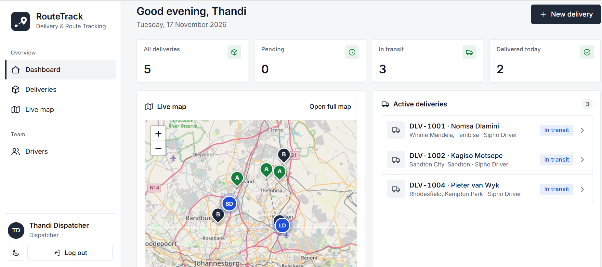
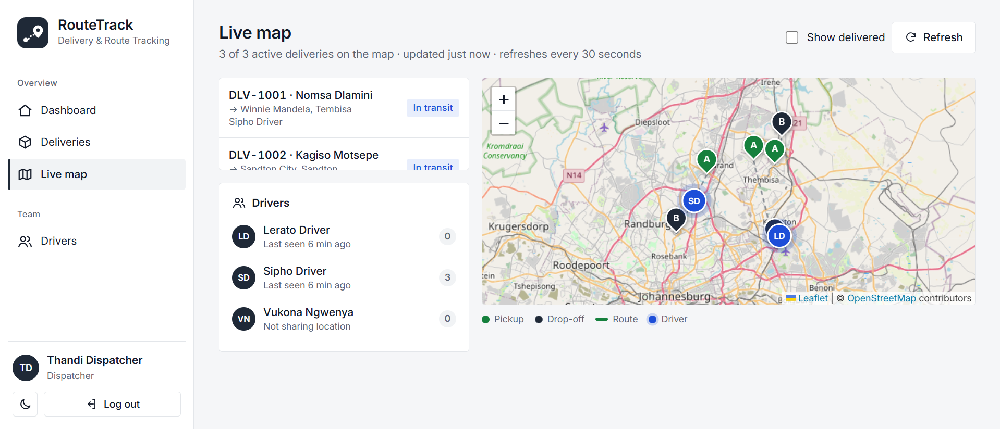
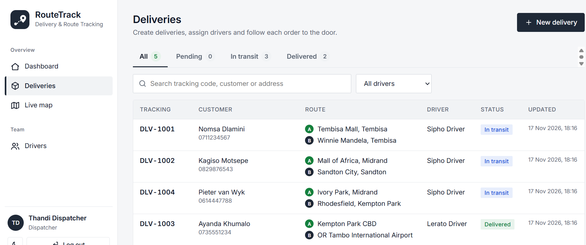
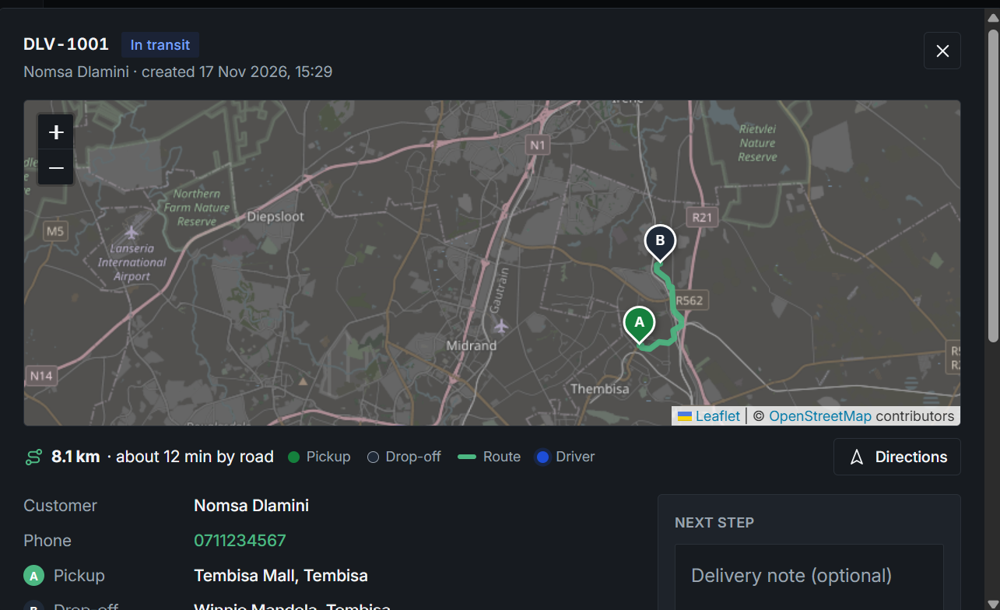
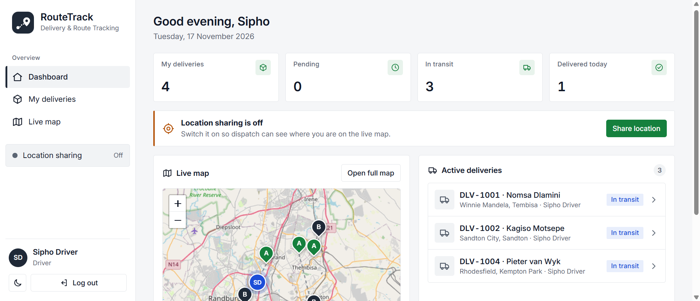

# RouteTrack — Delivery & Route Tracker

A full-stack delivery management app for dispatchers and drivers, with a live route map.

**Developer:** Vukona Ngwenya

## Screenshots

**Dispatcher dashboard:** live counts, a mini map and active deliveries


**Live map:** every active delivery (A = pickup, B = drop-off) and each driver's last shared position


**Deliveries:** filter by status or driver, and search by tracking code, customer or address


**Delivery details (dark mode):** driving route with distance and travel time, plus directions


**Driver view:** a driver sees only their own deliveries and can share their location


## Features
- **Two roles with JWT login:** dispatchers manage everything; drivers see only their own deliveries
- **Deliveries:** create, assign or reassign drivers, and move each one through
  `pending → in transit → delivered` (the server enforces the order)
- **Live map (Leaflet + OpenStreetMap):**
  - Addresses are turned into map positions automatically (geocoding with Nominatim)
  - The driving route, distance and travel time come from OSRM
  - Drivers can share their location, so dispatch sees them on the map (updates every 30 seconds)
  - "Directions" opens turn-by-turn navigation in Google Maps
- **History:** every status change and assignment is logged with who did it and when
- **Dashboard:** live counts, alerts for deliveries without a driver, active deliveries and a mini map
- Light and dark mode, and it works on phones (the side menu folds away)

## Tech stack
React 18 (Vite) · Leaflet · Node.js / Express · MySQL / MariaDB · JWT · bcrypt

## Run locally
1. Create the database: import `server/schema.sql` in phpMyAdmin, or run `mysql -u root -p < server/schema.sql`
2. Set up the server:
   ```bash
   cd server
   npm install
   cp .env.example .env      # Command Prompt / PowerShell: copy .env.example .env
   ```
   In `.env`, fill in your database password (leave it empty for XAMPP) and a long `JWT_SECRET`
3. Add the demo data, then start the API:
   ```bash
   npm run seed
   npm run dev
   ```
4. In a second terminal, start the website:
   ```bash
   cd client
   npm install
   npm run dev
   ```
5. Open http://localhost:5173

Demo logins (password `password123`): `dispatcher@demo.com`, `sipho@demo.com`, `lerato@demo.com`.
The login page also has one-click demo buttons.

### Updating from version 1.0
Your existing database is updated automatically when the server starts (it adds the map columns).
Run `npm run seed` once more to give the sample deliveries their map positions.

## Notes on the map services
RouteTrack uses free OpenStreetMap services: map tiles, Nominatim for addresses and the public OSRM server for routes.
They need no API key and are fine for a demo, but they limit how much you can use them.
A busy production app should use a paid provider or host its own copy (set `OSRM_URL` in `.env`).
If routing is unavailable, the app shows a straight-line estimate instead.

## Design
The interface uses the same design system as CareCollect, also built by Vukona Ngwenya:
the Inter font, an ink and green colour scheme, line icons and a side-menu layout.
